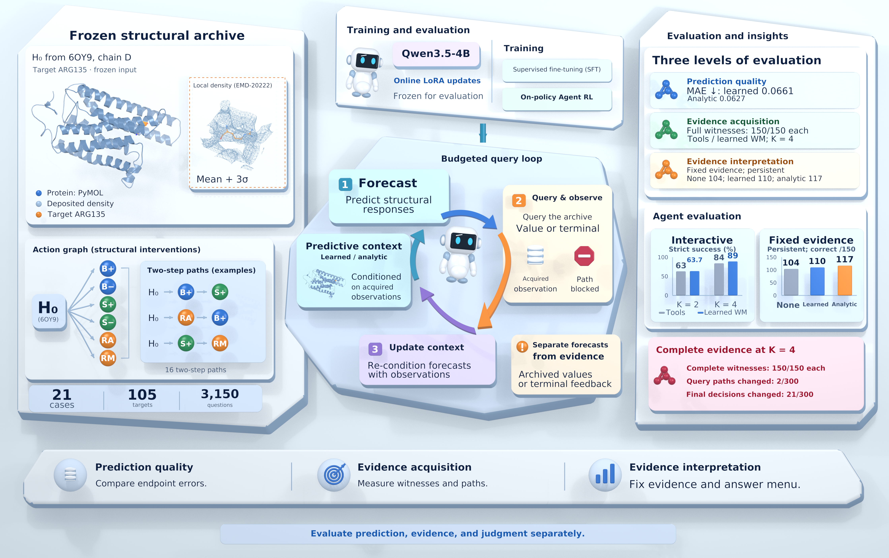

# InterveneLab
## World Model Assisted Reasoning over Structural Intervention Evidence

**Abstract**

When scientific agents consult predictive models, do forecasts change which evidence they gather or how they interpret it? InterveneLab separates these effects. Its 3,150 questions on 105 targets in 21 protein structure cases concern single-action, order, and interaction effects on local density response; budgeted queries return archived observations or recorded terminations. A Qwen3.5-4B agent trained with supervised fine-tuning and on-policy reinforcement learning receives forecasts from a learned structural model or an analytic prior. At budget K = 4, learned forecasts raise strict success on 300 development questions from 84% to 89%. The agent already gathers complete evidence for every answerable question without forecasts; adding them changes 21 final decisions but only two query paths, and 11 of the 14 extra correct numerical answers involve effects of exactly zero. With identical evidence, learned forecasts raise Qwen's cluster-weighted accuracy on 2,656 questions by 8.06 to 10.13 percentage points but cost Gemma3 83 correct answers; for Qwen, they show no clear advantage over analytic forecasts. In a prospective cohort of 13 components, the fine-tuned Qwen policies improve judgments on nonzero-effect questions, while the primary acquisition gain comes mostly from one component (76.4%). Predictive context mainly changes how an agent interprets evidence it already has, and whether it helps depends on the policy.
